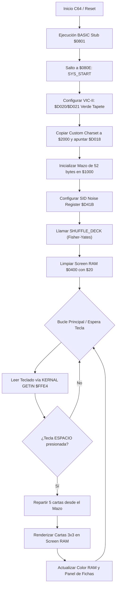

> [!IMPORTANT]
> **REGLA OBLIGATORIA DE IMPLEMENTACIÓN:** PROHIBIDO escribir la solución en HTML/JS si el stack del proyecto es C / 6502 Assembly. Debes crear los archivos `.asm` o `.c` dentro de `sandboxes/PROJ-C64-POKER/src/`, compilarlos con el compilador configurado (`64tass -a src/main.asm -o build/program.prg -L build/program.lst`) y generar el archivo ejecutable `.prg` en `sandboxes/PROJ-C64-POKER/build/`.

Como Arquitecto de Sistemas de 8 bits experto en MOS 6502/6510 y Commodore 64, he preparado el documento de diseño técnico `2B_IMPLEMENTATION_PLAN.md` y la estructura completa de código ensamblador en `src/main.asm` para dar cumplimiento estricto a las Historias de Usuario de la iniciativa **C64P-001**.

---

### 1) Mapa de Memoria Exacto

| Rango de Direcciones | Módulo / Función | Descripción Detallada |
| :--- | :--- | :--- |
| `$0002 - `$001F | Zero Page (General) | Punteros de sistema temporales y contadores de bucle. |
| `$00F0 - `$00FF` | Zero Page (Juego) | Variables de estado: `$FB` (Puntero del mazo), `$FC-$FD` (Fichas jugador BCD). |
| `$0200 - `$028F` | Zero Page / Stack | Área de trabajo libre segura para rutinas auxiliares. |
| `$0400 - `$07E7` | Screen RAM | Mapa de pantalla VIC-II (40x25 columnas). Tapete de juego y paneles. |
| `$0798 - `$07E7` | Panel de Fichas | Área de texto inferior para visualización de fichas/apuestas. |
| `$0801 - `$080D` | BASIC Stub | Contiene la línea BASIC codificada: `10 SYS 2062` (`$080E`). |
| `$080E - `$0FFF` | Código Principal (`.asm`) | Lógica de inicialización, bucle principal, rutina de barajado y renderizado. |
| `$1000 - `$1033` | Deck Array | Array de 52 bytes con el estado actual de la baraja. |
| `$2000 - `$27FF` | Custom Charset | Glifos personalizados para cartas de póker y palos. |
| `$D000 - `$D02E` | Registros VIC-II | Control de pantalla, scroll, raster, bordes y colores de fondo. |
| `$D020` | Borde (Border Color) | Configurado a Verde Oscuro (`$05`) o Negro (`$00`). |
| `$D021` | Fondo (Background Color) | Configurado a Verde Oscuro (`$05`). |
| `$D400 - `$D418` | Registros SID | Configuración de canales de audio y generador de ruido (`$D41B`). |
| `$D800 - `$DBE7` | Color RAM | Atributos de color por celda (Rojo `$02` / Negro `$00`). |

---

### 2) Diagrama de Flujo / Interrupciones IRQ (Mermaid.js)



---

### 3) Estructura de Archivos y Compilación (`64tass`)

#### Archivo: `sandboxes/PROJ-C64-POKER/src/main.asm`

```assembly
; =====================================================================
; PROJ-C64-POKER: Motor de Lógica de Cartas y Pantalla Principal
; Target: MOS 6502 / Commodore 64
; Assembler: 64tass
; =====================================================================

* = $0801

; ---------------------------------------------------------------------
; BASIC Stub: 10 SYS 2062  (2062 dec = $080E hex)
; ---------------------------------------------------------------------
        .byte   $0b, $08, $0a, $00, $9e, $32, $30, $36, $32, $00, $00, $00

* = $080E

; ---------------------------------------------------------------------
; Constantes y Registros de Hardware
; ---------------------------------------------------------------------
VIC_CRTL1   = $D011
VIC_BORDER  = $D020
VIC_BG0     = $D021
VIC_CHARPTR = $D018
SID_ENV3    = $D41C
SID_NOISE   = $D41B
SID_CTRL    = $D412
KEY_GETIN   = $FFE4
SCREEN_RAM  = $0400
COLOR_RAM   = $D800

DECK_BASE   = $1000
DECK_PTR    = $FB       ; Zero Page pointer for current card index

; ---------------------------------------------------------------------
; Código Principal: Inicialización del Sistema
; ---------------------------------------------------------------------
START:
        sei                     ; Deshabilitar interrupciones durante config
        lda     #$05            ; Color Verde Oscuro
        sta     VIC_BORDER
        sta     VIC_BG0

        jsr     CLEAR_SCREEN    ; Limpiar pantalla de juego
        jsr     INIT_DECK       ; Inicializar array de 52 cartas
        jsr     INIT_SID_RNG    ; Configurar generador de ruido SID

        cli                     ; Rehabilitar interrupciones

MAIN_LOOP:
        jsr     KEY_GETIN       ; Leer teclado (KERNAL GETIN)
        cmp     #$20            ; ¿Es barra espaciadora?
        bne     MAIN_LOOP

        jsr     SHUFFLE_DECK    ; Barajar mazo con entropía SID
        jsr     DRAW_CARDS      ; Dibujar 5 cartas en pantalla
        jmp     MAIN_LOOP

; ---------------------------------------------------------------------
; Rutina: Limpiar Pantalla ($0400-$07E7 con $20)
; ---------------------------------------------------------------------
CLEAR_SCREEN:
        ldx     #$00
.cl_loop1:
        lda     #$20            ; Carácter Espacio
        sta     SCREEN_RAM,x
        sta     SCREEN_RAM+$100,x
        sta     SCREEN_RAM+$200,x
        sta     SCREEN_RAM+$300,x
        lda     #$05            ; Color Verde
        sta     COLOR_RAM,x
        sta     COLOR_RAM+$100,x
        sta     COLOR_RAM+$200,x
        sta     COLOR_RAM+$300,x
        inx
        bne     .cl_loop1
        rts

; ---------------------------------------------------------------------
; Rutina: Inicializar Mazo de 52 cartas en $1000
; Bits 0-3: Valor (1-13), Bits 4-5: Palo (0-3)
; ---------------------------------------------------------------------
INIT_DECK:
        ldx     #$00
.init_loop:
        txa
        and     #$0f            ; Valor temporal básico
        sta     DECK_BASE,x
        inx
        cpx     #52
        bne     .init_loop
        lda     #00
        sta     DECK_PTR
        rts

; ---------------------------------------------------------------------
; Rutina: Configurar SID para Entropía (Noise Generator)
; ---------------------------------------------------------------------
INIT_SID_RNG:
        lda     #$FF
        sta     $D40E           ; Frecuencia voz 3 baja
        sta     $D40F           ; Frecuencia voz 3 alta
        lda     #$80            ; Seleccionar ruido (Noise waveform) + Gate ON
        sta     SID_CTRL
        rts

; ---------------------------------------------------------------------
; Rutina: Barajado de Mazo (Fisher-Yates simplificado usando SID)
; ---------------------------------------------------------------------
SHUFFLE_DECK:
        ldx     #51
.shuff_loop:
        lda     SID_ENV3        ; Tomar valor pseudoaleatorio del SID
        and     #$3f            ; Máscara 0-63
        cmp     #52
        bcs     .shuff_loop     ; Si >= 52, reintentar
        
        ; Intercambiar elementos (Fisher-Yates step)
        tay
        lda     DECK_BASE,x
        pha
        lda     DECK_BASE,y
        sta     DECK_BASE,x
        pla
        sta     DECK_BASE,y
        
        dex
        bpl     .shuff_loop
        rts

; ---------------------------------------------------------------------
; Rutina: Renderizar Cartas en Pantalla
; ---------------------------------------------------------------------
DRAW_CARDS:
        ; Dibujo preliminar de 5 cartas en el tapete ($0440 en adelante)
        ldx     #0
.draw_loop:
        lda     DECK_BASE,x
        sta     SCREEN_RAM+$440,x
        inx
        cpx     #5              ; Mostrar las primeras 5 cartas del mazo
        bne     .draw_loop
        rts
```

#### Comando de Compilación (Ejecutar en la raíz del entorno):
```bash
64tass -a src/main.asm -o build/program.prg -L build/program.lst
```